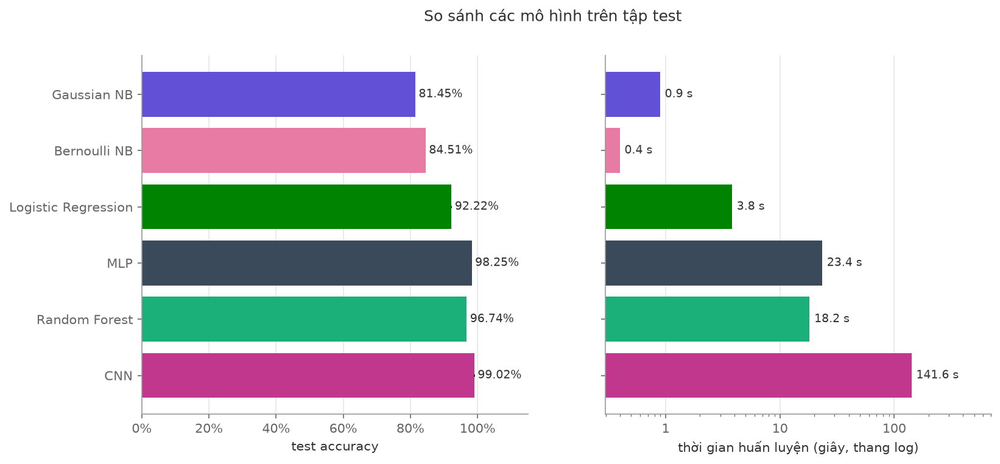

# Handwritten Digit Recognition with Classical and Neural Classifiers

**English** | [Tiếng Việt](README.vi.md)


Midterm project for the Pattern Recognition course. We implement four classifiers from
scratch (Naïve Bayes, Logistic Regression, MLP, Random Forest), train them on MNIST, and
compare them on accuracy, training time, prediction time and interpretability. Extensions:
a simple CNN, data augmentation, and Fashion-MNIST. scikit-learn is used only to
cross-check our results.



## Team

| Full name | Student ID | Responsibilities |
|---|---|---|
| Tran Ngoc Cac Uyen | 24280030 | Data preprocessing, metrics, Logistic Regression, MLP, CNN |
| Le Minh Phuc Tien | 24280107 | Naïve Bayes, Random Forest, data augmentation, Fashion-MNIST |

- **Course:** Pattern Recognition (MTH10322)
- **Instructor:** Dr. Truong Phuoc Hung
- **University:** University of Science, VNU-HCM

## Installation

Requires Python 3.10 or newer.

```bash
git clone https://github.com/trnngcccuyn/mnist-classifiers
cd mnist-classifiers
python -m venv .venv && source .venv/bin/activate   # Windows: .venv\Scripts\activate
pip install -r requirements.txt
```

The datasets are downloaded automatically into `data/` on first run.

## Usage

```bash
# Train and evaluate the four required models; tables are saved to results/tables/
python -m experiments.run_all --dataset mnist

# Hyperparameter experiments; figures are saved to results/figures/
python -m experiments.hyperparams.logistic_regression
python -m experiments.hyperparams.mlp
python -m experiments.hyperparams.cnn
python -m experiments.hyperparams.naive_bayes
python -m experiments.hyperparams.random_forest

# Extensions
python -m experiments.cnn_vs_mlp
python -m experiments.augmentation_exp
python -m experiments.seed_ensemble_tta
python -m experiments.run_all --dataset fashion_mnist

# Redraw the figures from the saved tables, without retraining
python -m experiments.make_figures --dataset mnist

# Cross-check against scikit-learn
pytest
```

The main results can be reproduced with `notebooks/main_results.ipynb`.

## Results

MNIST, 50,000 train / 10,000 validation / 10,000 test (split fixed with seed 42), using the
configurations chosen on validation in `experiments/run_all.py`. Models with randomness are
run with several seeds and reported as mean ± standard deviation; Naïve Bayes is
deterministic and runs once. Source: `results/tables/mnist_summary_agg.csv`.

| Model | Seeds | Train acc. | Val. acc. | Test acc. | Macro F1 (test) | Training time (s) | Prediction time, 10k images (s) |
|---|---|---|---|---|---|---|---|
| Gaussian Naïve Bayes | 1 | 80.26% | 79.91% | 81.45% | 0.8128 | 0.9 | 0.07 |
| Bernoulli Naïve Bayes | 1 | 83.45% | 83.52% | 84.51% | 0.8432 | 0.4 | 0.06 |
| Logistic Regression | 3 | 92.51% ± 0.05% | 91.74% ± 0.07% | 92.22% ± 0.12% | 0.9211 | 3.8 | 0.01 |
| MLP | 3 | 100.00% ± 0.00% | 98.01% ± 0.13% | 98.25% ± 0.10% | 0.9824 | 23.4 | 0.04 |
| Random Forest | 3 | 99.88% ± 0.01% | 96.65% ± 0.10% | 96.74% ± 0.01% | 0.9672 | 18.2 | 0.61 |
| CNN | 3 | 99.68% ± 0.22% | 98.83% ± 0.14% | 99.02% ± 0.18% | 0.9901 | 141.6 | 1.16 |

Times depend on the machine (CPU, number of cores, load) and are only comparable between
models run on the same machine. Random Forest trains its trees in parallel on all CPU cores.

## Project structure

```
mnist-classifiers/
├── src/
│   ├── data.py                 # loading, normalisation, flattening, splits
│   ├── metrics.py              # accuracy, precision, recall, F1, confusion matrix
│   ├── augmentation.py         # rotation, shift, noise
│   ├── utils.py                # seeding, timing
│   ├── plotting.py             # shared figure style
│   └── models/
│       ├── base.py             # shared fit / predict / predict_proba interface
│       ├── naive_bayes.py      # Gaussian and Bernoulli Naïve Bayes
│       ├── logistic_regression.py  # softmax regression with mini-batch GD
│       ├── mlp.py              # MLP with backpropagation
│       ├── random_forest.py    # ensemble
│       └── cnn.py              # simple CNN
├── experiments/                # experiment scripts
├── notebooks/                  # notebook reproducing the main results
├── tests/                      # cross-checks against scikit-learn
├── results/                    # tables/ and figures/
├── report/                     # PDF report
├── slides/                     # presentation slides
└── docs/PLAN.md                # work split and schedule
```

## Report and slides

- Report: `report/report.pdf` (TODO)
- Slides: `slides/` (TODO)

## References

TODO
