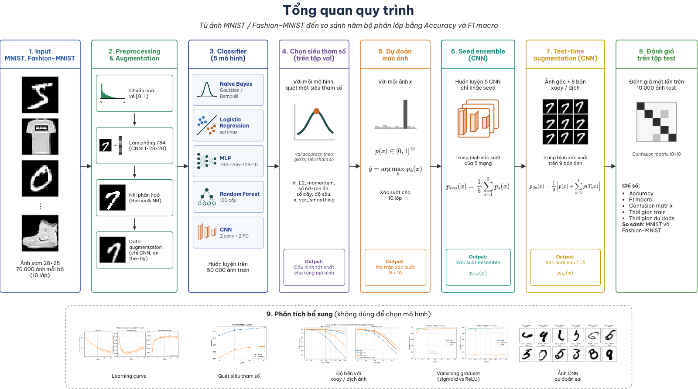
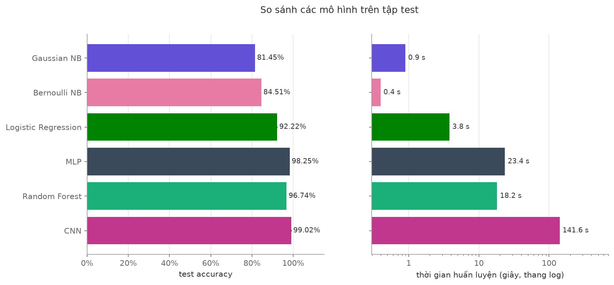

# Nhận dạng chữ số viết tay bằng các phương pháp phân lớp

[English](README.md) | **Tiếng Việt**


Đồ án giữa kỳ môn Nhận dạng mẫu. Nhóm tự cài đặt bốn bộ phân lớp (Naïve Bayes, Logistic
Regression, MLP, Random Forest), huấn luyện trên MNIST và so sánh về độ chính xác, thời
gian huấn luyện, thời gian dự đoán và khả năng giải thích. Phần mở rộng: CNN, tăng cường dữ
liệu, seed ensemble và test-time augmentation (TTA), ensemble nhiều loại mô hình, CNN cải
tiến, Fashion-MNIST và demo nhận dạng chữ số vẽ tay. scikit-learn chỉ được dùng để đối
chiếu kết quả.





## Thông tin nhóm

| Họ và tên | MSSV | Phụ trách |
|---|---|---|
| Trần Ngọc Các Uyên | 24280030 | Tiền xử lý dữ liệu, độ đo, Logistic Regression, MLP, CNN và CNN cải tiến, tăng cường dữ liệu, seed ensemble và TTA, notebook, demo |
| Lê Minh Phúc Tiên | 24280107 | Naïve Bayes, Random Forest, ensemble nhiều mô hình, Fashion-MNIST, hình quy trình |

- **Môn học:** Nhận dạng mẫu (MTH10322)
- **Giảng viên:** TS. Trương Phước Hưng
- **Trường:** Đại học Khoa học tự nhiên, ĐHQG-HCM

## Cài đặt

Yêu cầu Python 3.10 trở lên.

```bash
git clone https://github.com/trnngcccuyn/mnist-classifiers
cd mnist-classifiers
python -m venv .venv && source .venv/bin/activate   # Windows: .venv\Scripts\activate
pip install -r requirements.txt
```

Dữ liệu được tải tự động vào `data/` ở lần chạy đầu tiên.

## Cách chạy

```bash
# Huấn luyện và đánh giá 4 mô hình bắt buộc + CNN; bảng lưu vào results/tables/
python -m experiments.run_all --dataset mnist

# Thí nghiệm siêu tham số; biểu đồ lưu vào results/figures/
python -m experiments.hyperparams.logistic_regression
python -m experiments.hyperparams.mlp
python -m experiments.hyperparams.cnn
python -m experiments.hyperparams.naive_bayes
python -m experiments.hyperparams.random_forest
python -m experiments.vanishing_gradient

# Phần mở rộng trên MNIST
python -m experiments.cnn_vs_mlp
python -m experiments.augmentation_exp
python -m experiments.seed_ensemble_tta
python -m experiments.cnn_improved                                   # ablation, seed 0
python -m experiments.cnn_improved --configs v2_full --seeds 0 1 2   # cấu hình cuối, 3 seed
python -m experiments.model_ensemble       # cần chạy run_all trước

# Fashion-MNIST
python -m experiments.run_all --dataset fashion_mnist
python -m experiments.fashion_vs_mnist
python -m experiments.hyperparams.cnn --dataset fashion_mnist --epochs 30
python -m experiments.augmentation_exp --dataset fashion_mnist
python -m experiments.augmentation_ablation --seeds 0 1 2
python -m experiments.seed_ensemble_tta --dataset fashion_mnist
python -m experiments.model_ensemble --dataset fashion_mnist

# Vẽ lại các hình từ bảng đã lưu, không phải train lại
python -m experiments.make_figures --dataset mnist

# Kiểm thử (gồm đối chiếu với scikit-learn)
pytest
```

Các script có CNN chạy lâu trên CPU (mỗi lần train CNN khoảng 2–10 phút; `seed_ensemble_tta`
và `cnn_improved` mất khoảng 30–60 phút). Hai script này lưu từng lần train vào
`results/cache/` (không commit), nên chạy lại sẽ bỏ qua phần đã xong.

`notebooks/main_results.ipynb` tái tạo kết quả chính trong vài phút: train lại các mô hình
nhanh để đối chiếu với bảng đã lưu, và tính lại accuracy của mọi mô hình (kể cả CNN) từ xác
suất dự đoán đã lưu trong `results/probs/`.

### Demo

Demo nhận dạng chữ số vẽ tay (Gradio), dùng mô hình cuối: ensemble 3 CNN cải tiến `v2_full`.
Cần trọng số `results/cache/mnist/cnn_improved/v2_full_seed{0,1,2}.pt` (không commit; tạo bằng
`python -m experiments.cnn_improved --configs v2_full --seeds 0 1 2`).

```bash
pip install "gradio>=5"
python -m demo.app            # mở http://127.0.0.1:7860
python -m demo.app --check    # kiểm tra trọng số: accuracy test phải là 99.63%
```

Hai tab: vẽ chữ số (ảnh vẽ được đưa về dạng MNIST 28×28 trước khi dự đoán), hoặc lấy ngẫu
nhiên ảnh test MNIST, có tuỳ chọn chỉ lấy các ảnh mô hình đoán sai.

## Kết quả

### MNIST: các mô hình bắt buộc và CNN

50.000 train / 10.000 validation / 10.000 test (chia cố định với seed 42), dùng cấu hình đã
chọn theo validation trong `experiments/run_all.py`. Mô hình có yếu tố ngẫu nhiên được chạy
với nhiều seed, ghi trung bình ± độ lệch chuẩn; Naïve Bayes tất định nên chạy một lần.
Nguồn: `results/tables/mnist_summary_agg.csv`.

| Mô hình | Số seed | Acc. train | Acc. val. | Acc. test | F1 macro (test) | TG huấn luyện (s) | TG dự đoán 10k ảnh (s) |
|---|---|---|---|---|---|---|---|
| Gaussian Naïve Bayes | 1 | 80.26% | 79.91% | 81.45% | 0.8128 | 0.9 | 0.07 |
| Bernoulli Naïve Bayes | 1 | 83.45% | 83.52% | 84.51% | 0.8432 | 0.4 | 0.06 |
| Logistic Regression | 3 | 92.51% ± 0.05% | 91.74% ± 0.07% | 92.22% ± 0.12% | 0.9211 | 3.8 | 0.01 |
| MLP | 3 | 100.00% ± 0.00% | 98.01% ± 0.13% | 98.25% ± 0.10% | 0.9824 | 23.4 | 0.04 |
| Random Forest | 3 | 99.88% ± 0.01% | 96.65% ± 0.10% | 96.74% ± 0.01% | 0.9672 | 18.2 | 0.61 |
| CNN | 3 | 99.68% ± 0.22% | 98.83% ± 0.14% | 99.02% ± 0.18% | 0.9901 | 141.6 | 1.16 |

Thời gian phụ thuộc máy (CPU, số nhân, máy đang bận) nên chỉ so được giữa các mô hình chạy
trên cùng một máy. Random Forest train các cây song song trên mọi nhân CPU.

### MNIST: phần mở rộng

| Cấu hình | Số seed | Acc. val. | Acc. test | Nguồn |
|---|---|---|---|---|
| CNN + tăng cường dữ liệu | 5 | 99.03% | 99.11% ± 0.17% | `seed_ensemble_members.csv` |
| CNN + tăng cường dữ liệu + TTA | 5 | 99.04% | 99.18% ± 0.17% | `seed_ensemble_tta_summary.csv` |
| Seed ensemble 5 CNN | 5 | 99.14% | 99.24% | `seed_ensemble.csv` |
| Seed ensemble 5 CNN + tăng cường dữ liệu | 5 | 99.39% | 99.38% | `seed_ensemble.csv` |
| Ensemble nhiều mô hình, trọng số chọn trên val (MLP, RF, CNN) | 1 | 98.99% | 99.26% | `model_ensemble_summary.csv` |
| CNN cải tiến (BatchNorm, Dropout, lịch lr cosine) | 3 | 99.45% ± 0.03% | 99.55% ± 0.06% | `cnn_improved_agg.csv` |
| **Ensemble 3 CNN cải tiến (mô hình cuối, chọn theo val)** | 3 | **99.49%** | **99.63%** | `cnn_improved_agg.csv` |

Độ bền với ảnh test bị biến đổi (trung bình 3 seed; nguồn `augmentation_robustness.csv`):

| Ảnh test | MLP | MLP + aug | CNN | CNN + aug |
|---|---|---|---|---|
| Gốc | 98.25% | 98.41% | 99.02% | 99.05% |
| Dịch 2 px | 83.3% | 98.0% | 94.9% | 98.8% |
| Dịch 4 px | 34.2% | 88.4% | 61.2% | 94.1% |
| Xoay 20° | 90.0% | 94.3% | 94.3% | 96.5% |

### Fashion-MNIST

Cùng cách chia và cùng cấu hình như MNIST. Nguồn: `results/tables/fashion_vs_mnist.csv`.

| Mô hình | Acc. test Fashion-MNIST | Giảm so với MNIST |
|---|---|---|
| Gaussian Naïve Bayes | 67.35% | −14.1 điểm |
| Bernoulli Naïve Bayes | 72.13% | −12.4 điểm |
| Logistic Regression | 84.08% ± 0.20% | −8.1 điểm |
| MLP | 87.69% ± 0.50% | −10.6 điểm |
| Random Forest | 87.20% ± 0.09% | −9.6 điểm |
| CNN | 90.24% ± 0.20% | −8.8 điểm |

Seed ensemble 5 CNN đạt 91.43%. Tăng cường dữ liệu thiết kế cho chữ số (xoay, dịch, nhiễu)
làm CNN giảm còn 86.37%, và TTA trên CNN không tăng cường giảm còn 80.53%
(`fashion_mnist_augmentation_agg.csv`, `fashion_mnist_seed_ensemble_tta_summary.csv`).

### Kết luận chính

- Thứ tự accuracy phản ánh mức độ mô hình dùng cấu trúc của ảnh: Naïve Bayes < Logistic
  Regression < Random Forest < MLP < CNN, trên cả MNIST và Fashion-MNIST.
- CNN hơn MLP ở cùng số tham số (225 nghìn so với 235 nghìn). Khi xáo thứ tự pixel, MLP gần
  như không đổi còn CNN giảm 2.7 điểm: lợi thế của CNN đến từ cấu trúc không gian của ảnh.
- Tăng cường dữ liệu gần như không đổi accuracy trên test gốc, nhưng giảm overfit và tăng
  mạnh độ bền khi ảnh bị dịch. Trên Fashion-MNIST, các phép biến đổi dành cho chữ số lại gây hại.
- Seed ensemble tăng khoảng 0.3 điểm cho CNN. TTA chỉ không gây hại khi mô hình đã được train
  với tăng cường dữ liệu, và không giúp thêm trên validation.
- Lịch learning rate cosine là thay đổi duy nhất trong ablation CNN cải tiến tạo khác biệt rõ:
  kết quả ổn định hơn (độ lệch theo seed giảm khoảng 3 lần) và một mạng đã hơn ensemble 5 CNN.

Phân tích đầy đủ trong `notebooks/main_results.ipynb`.

## Cấu trúc thư mục

```
mnist-classifiers/
├── src/
│   ├── data.py                 # tải, chuẩn hoá, làm phẳng, chia tập
│   ├── metrics.py              # accuracy, precision, recall, F1, confusion matrix
│   ├── augmentation.py         # xoay, dịch, nhiễu, lật ngang (tự cài bằng NumPy)
│   ├── tta.py                  # test-time augmentation
│   ├── ensemble.py             # soft / hard voting, tìm trọng số
│   ├── utils.py                # seed, đo thời gian, lưu xác suất
│   ├── plotting.py             # kiểu vẽ hình dùng chung
│   └── models/
│       ├── base.py             # interface chung fit / predict / predict_proba
│       ├── naive_bayes.py      # Gaussian và Bernoulli Naïve Bayes
│       ├── logistic_regression.py  # softmax regression + mini-batch GD
│       ├── nn_utils.py         # softmax, cross-entropy dùng chung cho LR và MLP
│       ├── mlp.py              # MLP + backpropagation
│       ├── random_forest.py    # cây quyết định + rừng
│       └── cnn.py              # CNN (theo bài giảng) và CNN cải tiến
├── experiments/                # script chạy thí nghiệm
├── demo/                       # demo Gradio (app.py, preprocess.py)
├── notebooks/                  # notebook tái tạo kết quả chính
├── tests/                      # kiểm thử, gồm đối chiếu với scikit-learn
├── results/
│   ├── tables/                 # bảng kết quả (CSV)
│   ├── figures/                # hình
│   └── probs/                  # xác suất dự đoán trên val/test, dùng cho ensemble và notebook
└── docs/PLAN.md                # phân công và kế hoạch
```

## Báo cáo và slide

Báo cáo và slide được nộp riêng, không lưu trong repo.

## Tài liệu tham khảo

- Y. LeCun, L. Bottou, Y. Bengio, P. Haffner. Gradient-based learning applied to document
  recognition. *Proceedings of the IEEE*, 1998. (MNIST)
- H. Xiao, K. Rasul, R. Vollgraf. Fashion-MNIST: a novel image dataset for benchmarking
  machine learning algorithms. arXiv:1708.07747, 2017.
- L. Breiman. Random forests. *Machine Learning*, 2001.
- D. P. Kingma, J. Ba. Adam: a method for stochastic optimization. ICLR, 2015.
- S. Ioffe, C. Szegedy. Batch normalization: accelerating deep network training by reducing
  internal covariate shift. ICML, 2015.
- N. Srivastava và cộng sự. Dropout: a simple way to prevent neural networks from overfitting.
  *JMLR*, 2014.
- I. Loshchilov, F. Hutter. SGDR: stochastic gradient descent with warm restarts. ICLR, 2017.
  (lịch learning rate cosine)
- F. Pedregosa và cộng sự. Scikit-learn: machine learning in Python. *JMLR*, 2011.
- A. Paszke và cộng sự. PyTorch: an imperative style, high-performance deep learning library.
  NeurIPS, 2019.
- Bài giảng môn Nhận dạng mẫu (MTH10322), TS. Trương Phước Hưng.
